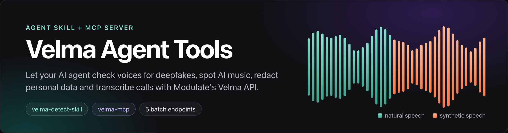
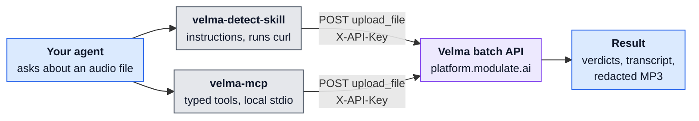
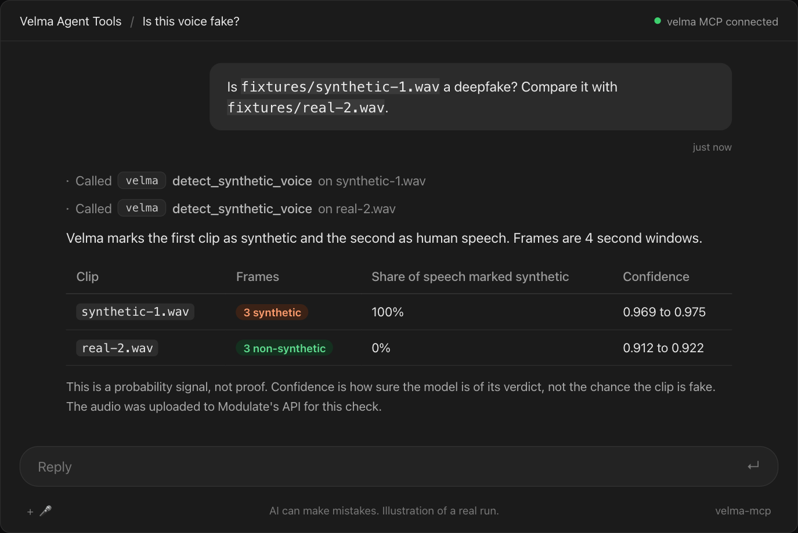
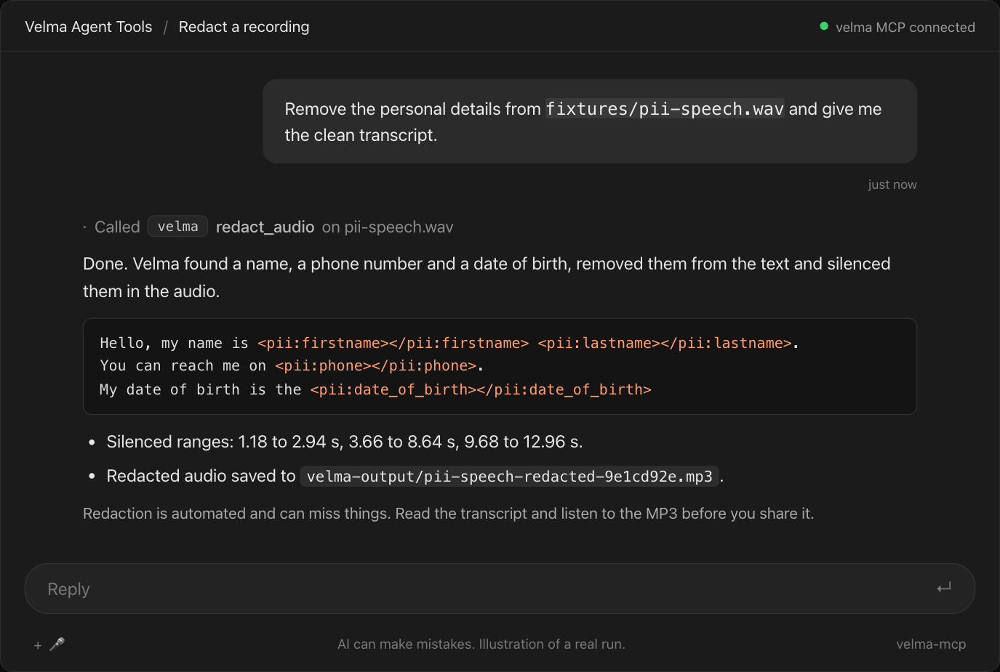
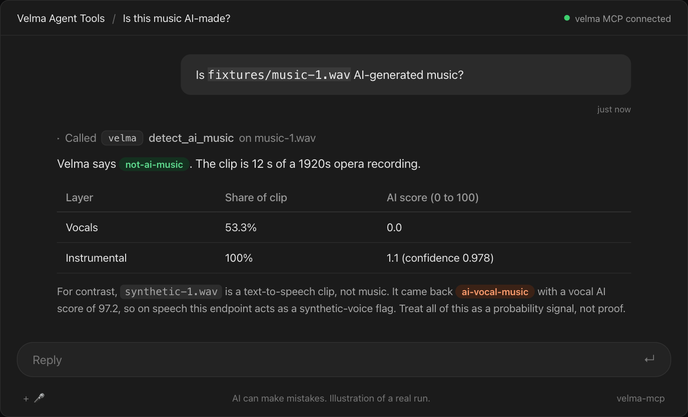
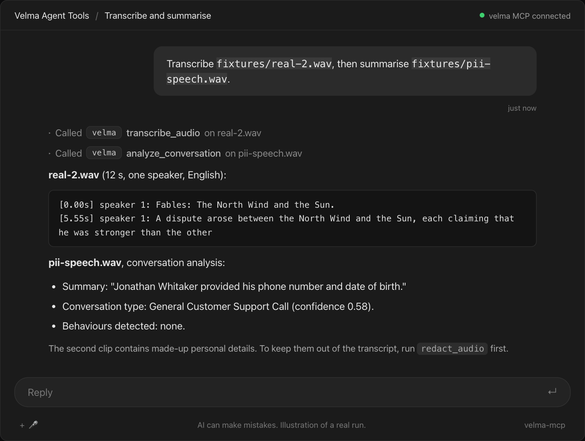

# Velma Agent Tools

[](./LICENSE)
[](https://agentskills.io/specification)
[](https://modelcontextprotocol.io)
[](https://www.python.org)

Give your AI agent [Modulate's Velma](https://docs.modulate.ai) voice AI. Ask it "is this voice fake?", "is this song AI-made?", "remove personal data from this call" or "transcribe this meeting", and it calls the Velma API for you.

This repo has two ways to do that. Both cover the same five batch endpoints, so pick the one that fits your agent.

Modulate owns the Velma API and its trademarks. This is an independent integration prepared by Infrasity Labs for Modulate.

## Pick one

| | [`velma-detect-skill`](./velma-detect-skill) | [`velma-mcp`](./velma-mcp) |
| - | - | - |
| What it is | An Agent Skill: `SKILL.md` plus references | A local MCP server in Python |
| How the agent calls Velma | Runs `curl` from the skill's instructions | Calls typed tools |
| Runs anything? | No, just instructions | Yes, a local stdio process |
| Works with | Cursor, Gemini CLI and other agents that read Agent Skills | Cursor, Windsurf and other MCP clients |
| Needs | `curl` (`jq` and `ffmpeg` optional) | `uv` and Python 3.10+ |
| Guards | Safety rules in the instructions | Files readable only under a base folder, key scrubbed from errors |

You can use both. They do not depend on each other.

## What they do

| Job | Endpoint | MCP tool |
| - | - | - |
| Is this voice fake, cloned or AI-generated? | `POST /api/velma-2-synthetic-voice-detection-batch` | `detect_synthetic_voice` |
| Is this music AI-made? | `POST /api/velma-2-ai-music-detection-batch` | `detect_ai_music` |
| Remove personal data (PII/PHI) from a recording | `POST /api/velma-2-pii-phi-redaction-batch` | `redact_audio` |
| Transcribe a call, with speakers, emotion, accent | `POST /api/velma-2-stt-batch` | `transcribe_audio` |
| Summarise a conversation, find topics and behaviours | `POST /api/velma-2-batch` | `analyze_conversation` |

Streaming (WebSocket) endpoints are not covered yet.

## Quickstart

1. Get a key at https://platform.modulate.ai/signup-request. New accounts get free credits. Then export it, and never commit it:

```bash
export VELMA_API_KEY=your-key-here
```

2. Install the skill, the MCP server, or both:

```bash
# Skill: installs into your agent's skills folder
npx skills add modulate-ai/velma-agent-tools
```

For the MCP server, add this block to your MCP client's config (for example `~/.cursor/mcp.json` or `~/.codeium/windsurf/mcp_config.json`). It needs [uv](https://docs.astral.sh/uv/):

```json
{
  "mcpServers": {
    "velma": {
      "command": "uvx",
      "args": ["--from", "git+https://github.com/modulate-ai/velma-agent-tools#subdirectory=velma-mcp", "velma-mcp"],
      "env": {
        "VELMA_API_KEY": "<your-key>",
        "VELMA_MCP_BASE_PATH": "/Users/you/Audio"
      }
    }
  }
}
```

Working from a checkout instead? Use `"args": ["--from", "/absolute/path/to/velma-agent-tools/velma-mcp", "velma-mcp"]`. All settings are in the [MCP README](./velma-mcp/README.md).

3. Ask your agent, for example:
   - "Is `fixtures/synthetic-1.wav` a deepfake?"
   - "Redact the names and phone numbers from `fixtures/pii-speech.wav`."
   - "Transcribe `call.wav` with speaker labels and emotion."

## How it works



Pick the skill or the server, or use both. Blue steps are the agent, grey steps run on your machine, purple is Modulate's API. Both paths send the same requests to the same five endpoints, and the API key stays on your machine. The MCP server also limits which local files can be read to `VELMA_MCP_BASE_PATH` and saves redacted audio to a file, an MCP resource, or both.

## See it in action

Four example chats with the MCP server, illustrated from real runs against the live Velma API with the clips in `fixtures/`.

<table>
<tr>
<td width="50%"><br><sub>Deepfake check: <code>detect_synthetic_voice</code></sub></td>
<td width="50%"><br><sub>Redaction: <code>redact_audio</code></sub></td>
</tr>
<tr>
<td width="50%"><br><sub>AI music check: <code>detect_ai_music</code></sub></td>
<td width="50%"><br><sub>Transcribe and summarise: <code>transcribe_audio</code>, <code>analyze_conversation</code></sub></td>
</tr>
</table>

## Results on the bundled clips

Run on 2026-11-02 against the live API.

| Clip | Result | Confidence |
| - | - | - |
| `fixtures/synthetic-1.wav` (text-to-speech) | 3 of 3 deepfake frames synthetic | 0.969 to 0.975 |
| `fixtures/real-2.wav` (human reading) | 3 of 3 deepfake frames non-synthetic | 0.912 to 0.922 |
| `fixtures/pii-speech.wav` (made-up name, phone, date of birth) | All three spans tagged and silenced | n/a |

Results are probability signals, not proof. A few short studio-style clips are not a benchmark. Sources and licences for every clip are in [`fixtures/SOURCES.md`](./fixtures/SOURCES.md).

## Repo layout

```text
.
  fixtures/            shared test clips and their sources
  velma-detect-skill/  SKILL.md, references/, scripts/, evals/ (trigger prompts)
  velma-mcp/           src/, tests/, pyproject.toml
  docs/images/         screenshots used in this README
  .github/workflows/   skill validation and MCP tests
```

## Develop

```bash
skills-ref validate ./velma-detect-skill        # skill format check
cd velma-mcp && uv run pytest                   # live tests run only with VELMA_API_KEY set
```

See [`CHANGELOG.md`](./CHANGELOG.md) for what is in each release.

## Privacy and safety

- Every call uploads audio to Modulate's API. Per Modulate's FAQ, self-service accounts are enrolled in model improvement unless they opt out with Modulate. Do not send audio you may not share.
- The API key lives only in your environment or a gitignored `.env`. Neither project logs it.
- Spot-check redacted output before sharing it.

## Links

- [Velma docs](https://docs.modulate.ai), [authentication and limits](https://docs.modulate.ai/guides/authentication.md), [troubleshooting](https://docs.modulate.ai/guides/troubleshooting.md)
- [Agent Skills specification](https://agentskills.io/specification), [Model Context Protocol](https://modelcontextprotocol.io)

## Licence

MIT. Copyright (c) 2026 Modulate AI. See [`LICENSE`](./LICENSE).
