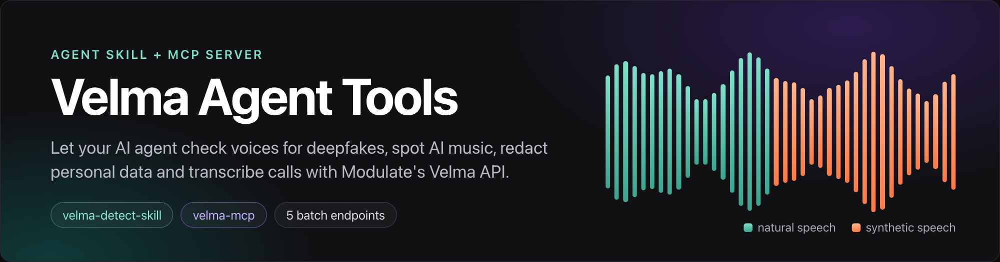

# Velma Detect Skill

Part of [Velma Agent Tools](../README.md). Prefer typed tools over shell commands? See the companion [`velma-mcp`](../velma-mcp) server.
[](./LICENSE) [](https://agentskills.io/specification)

An agent skill for voice deepfake detection, AI music detection, PII/PHI redaction and transcription, powered by [Modulate's Velma API](https://docs.modulate.ai).

Give any coding agent the ability to answer "is this voice fake?", "is this song AI-made?", "remove personal data from this recording" and "transcribe this call". It uses plain `curl`. No MCP server is needed.

Modulate owns the Velma API and its trademarks. This is an independent integration prepared by Infrasity Labs for Modulate.

## Install

Once published:

```bash
npx skills add <owner>/velma-agent-tools
```

Or copy the folder by hand into your agent's skills directory:

| Agent | Project path | Status |
| - | - | - |
| [Claude Code](https://claude.ai/code) | `.claude/skills/velma-detect-skill/` | Tested |
| [Cursor](https://cursor.com) | `.cursor/skills/velma-detect-skill/` | Same format, not tested |
| [Gemini CLI](https://github.com/google-gemini/gemini-cli) | `.gemini/skills/velma-detect-skill/` | Same format, not tested |

Any other agent that reads [Agent Skills](https://agentskills.io/specification) and can run `curl` should work.
Manual copy: `git clone https://github.com/<owner>/velma-agent-tools && cp -R velma-agent-tools/velma-detect-skill .claude/skills/`

## Requirements

- A Velma API key. Sign up at https://platform.modulate.ai/signup-request, then create a key on the API Keys page. New accounts get free credits.
- `curl`. `jq` and `ffmpeg` are optional (summaries and cutting long files).
- Export the key. Never paste it into chat or commit it:

```bash
export VELMA_API_KEY=your-key-here
```

## What it does

| Ask | Endpoint |
| - | - |
| Is this voice fake, cloned or AI-generated? | `POST /api/velma-2-synthetic-voice-detection-batch` |
| Is this music AI-made? | `POST /api/velma-2-ai-music-detection-batch` |
| Remove names, numbers and health data from a recording | `POST /api/velma-2-pii-phi-redaction-batch` |
| Transcribe a call, with speakers, emotion, accent | `POST /api/velma-2-stt-batch` |
| Summarise a conversation, find topics and behaviours | `POST /api/velma-2-batch` |

Streaming (WebSocket) endpoints exist for most of these. They are not covered yet.

## 30-second demo

From the repo root, ask your agent: "Is `fixtures/synthetic-1.wav` a deepfake?" The skill runs:

```bash
curl -sS -X POST https://platform.modulate.ai/api/velma-2-synthetic-voice-detection-batch \
  -H "X-API-Key: $VELMA_API_KEY" \
  -F "upload_file=@fixtures/synthetic-1.wav"
```

Real reply for that clip (a Piper text-to-speech voice, 9.3 s):

```json
{"filename":"synthetic-1.wav","frames":[
 {"start_time_ms":0,"end_time_ms":4000,"verdict":"synthetic","confidence":0.9717},
 {"start_time_ms":4000,"end_time_ms":8000,"verdict":"synthetic","confidence":0.9749},
 {"start_time_ms":8000,"end_time_ms":9334,"verdict":"synthetic","confidence":0.9693}],
 "duration_ms":9334}
```

The agent reports the share of speech marked synthetic (here 100 percent), the confidence range (0.97), and that this is a probability signal, not proof.

## Results on the bundled fixtures

Run on 2026-11-02 against the live API.

| Clip | Deepfake result | Confidence |
| - | - | - |
| `synthetic-1.wav` (text-to-speech) | 3 of 3 frames synthetic | 0.969 to 0.975 |
| `real-1.wav` (human reading) | 3 of 3 frames non-synthetic | 0.896 to 0.921 |
| `real-2.wav` (human reading) | 3 of 3 frames non-synthetic | 0.912 to 0.922 |
| `music-1.wav` (1920s opera recording) | `not-ai-music` | n/a |

Four short studio-style clips are not a benchmark. Do not tune thresholds on them. Sources and licences are in [`fixtures/SOURCES.md`](../fixtures/SOURCES.md).

## How it works

- `SKILL.md`: decision tree, one curl per endpoint, how to read scores, input rules, errors, safety. Under 500 lines.
- `references/`: one file per endpoint plus errors and limits. Loaded only when needed.
- `scripts/split_redaction.py`: splits the multipart redaction reply into `metadata.json` and `redacted.mp3`.
- `evals/`: 12 trigger prompts (8 should fire, 4 should not) and a runner for Claude Code.

## Limits

- 100 MB per file. 3 requests in flight per model by default. Credits are separate.
- Deepfake detection: 4 to 60 second clips work best. Under 0.5 seconds is rejected.
- Redaction, transcription and conversation analysis take `.aac .aiff .flac .mov .mp3 .mp4 .ogg .opus .wav .webm`.
- Audio is uploaded to Modulate's API. Read their privacy notes before sending sensitive audio.
- Results are probability signals, not proof. Spot-check redacted output.

## Check it yourself

```bash
pip install "git+https://github.com/agentskills/agentskills#subdirectory=skills-ref"
skills-ref validate ./velma-detect-skill
./evals/run_trigger_eval.sh    # needs the claude CLI, jq and a Claude login
```

## Links

- [Velma docs](https://docs.modulate.ai), [authentication and limits](https://docs.modulate.ai/guides/authentication.md), [troubleshooting](https://docs.modulate.ai/guides/troubleshooting.md)
- [Agent Skills specification](https://agentskills.io/specification)

## Licence

MIT. Copyright (c) 2026 Modulate AI. See [`LICENSE`](./LICENSE).
