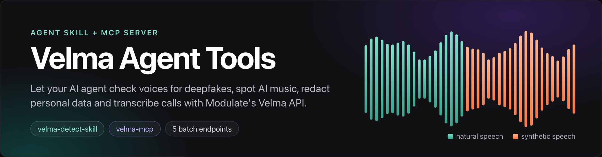
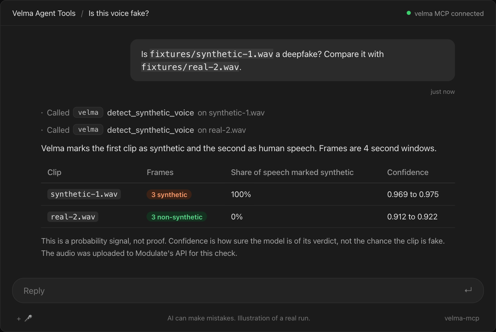
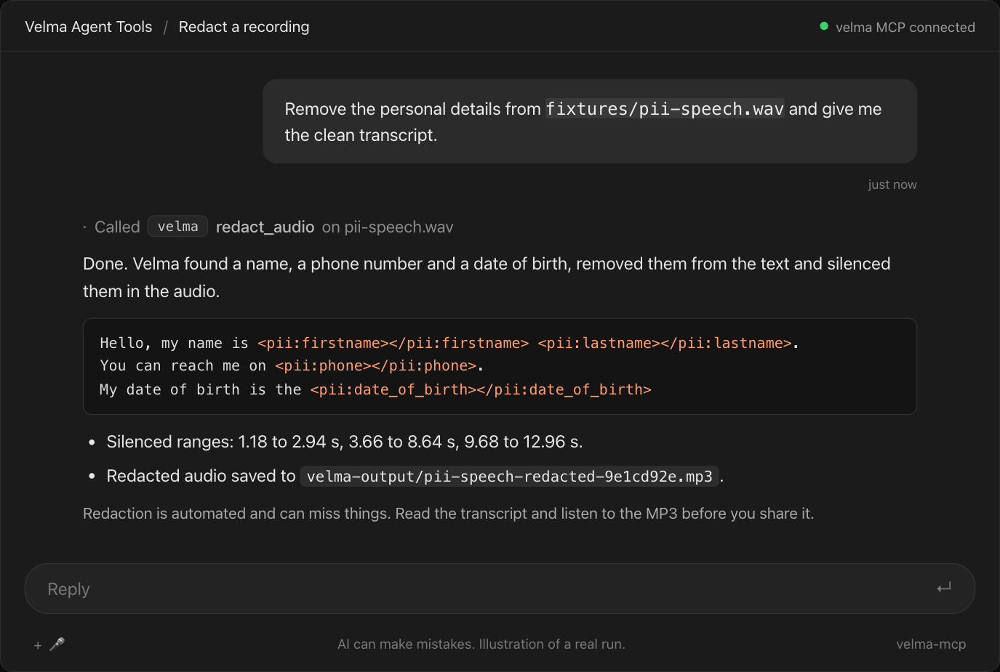
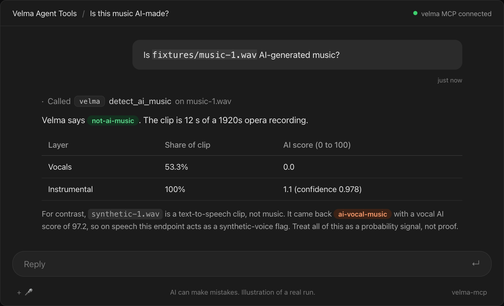
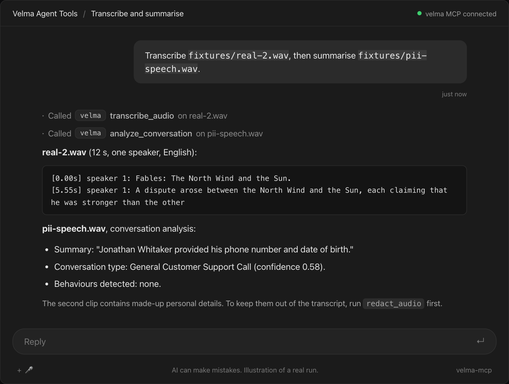

# Velma MCP

Part of [Velma Agent Tools](../README.md). Prefer plain instructions over a running server? See the companion [`velma-detect-skill`](../velma-detect-skill).

[](./LICENSE)
[](https://www.python.org)
[](https://modelcontextprotocol.io)

A local [Model Context Protocol](https://modelcontextprotocol.io) server for [Modulate's Velma](https://docs.modulate.ai) voice AI. It lets MCP clients such as Cursor and Windsurf check a recording for deepfake voices or AI music, redact personal data, transcribe, and analyse a conversation.

Modulate owns the Velma API and its trademarks. This is an independent client prepared by Infrasity Labs for Modulate.

## Quickstart

1. Get a Velma API key: sign up at https://platform.modulate.ai/signup-request, then create a key on the API Keys page. New accounts get free credits.
2. Install [uv](https://docs.astral.sh/uv/). It needs Python 3.10 or newer.
3. Add the server to your MCP client. Cursor (`~/.cursor/mcp.json`) and Windsurf (`~/.codeium/windsurf/mcp_config.json`) use the same block:

```json
{
  "mcpServers": {
    "velma": {
      "command": "uvx",
      "args": ["--from", "git+https://github.com/modulate-ai/velma-agent-tools#subdirectory=velma-mcp", "velma-mcp"],
      "env": {
        "VELMA_API_KEY": "<your-key>",
        "VELMA_MCP_BASE_PATH": "/Users/you/Audio"
      }
    }
  }
}
```

Working from a checkout instead? Replace `"args"` with `["--from", "/absolute/path/velma-agent-tools/velma-mcp", "velma-mcp"]`. Other clients take the same `command`, `args` and `env` values in their own config format.

## Example prompts

- "Is `call.wav` a synthetic voice?"
- "Does `track.mp3` sound like AI-generated music?"
- "Redact personal details from `interview.wav`."
- "Transcribe `meeting.mp3` with speakers and emotion."
- "Summarise the support call `case-42.wav` and list the topics."

Each call uploads the file to Modulate's API and uses credits.

## Tools

| Tool | What it does |
| - | - |
| `detect_synthetic_voice(file_path)` | Frame-by-frame deepfake check. Returns a summary (frame counts, share of speech marked synthetic, mean confidences) and the raw frames. |
| `detect_ai_music(file_path)` | Returns `primary_verdict` (`ai-vocal-music`, `ai-instrumental`, `not-ai-music`), vocal and instrumental AI percentages, and windows. |
| `redact_audio(file_path, language?, speaker_diarization?)` | Returns the redacted transcript, utterances and silenced ranges, plus the redacted MP3 as a file, a resource, or both. |
| `transcribe_audio(file_path, speaker_diarization?, emotion_signal?, accent_signal?, deepfake_signal?, pii_phi_tagging?, language?)` | Returns text and utterances with the signals you ask for. |
| `analyze_conversation(file_path, config?)` | Velma Triage: summary, topics, conversation type, behaviours. `config` is `default` or a JSON `BatchConfig`. |

Detection results are probability signals, not proof. Spot-check redacted output before sharing it.

## In action

Example chats illustrated from real runs against the live API with the clips in `../fixtures/`.









## Example result

`detect_synthetic_voice` on a text-to-speech clip (trimmed, real run):

```json
{"filename": "synthetic-1.wav", "duration_ms": 9334,
 "summary": {"frame_counts": {"synthetic": 3, "non-synthetic": 0, "no-content": 0},
             "synthetic_share_of_non_silent_frames": 1.0,
             "mean_confidence_synthetic_frames": 0.972,
             "majority_verdict": "synthetic"},
 "frames": [{"start_time_ms": 0, "end_time_ms": 4000, "verdict": "synthetic", "confidence": 0.9717}]}
```

On a human reading (`real-2.wav`) all 3 frames came back `non-synthetic`, mean confidence 0.917.

## Environment variables

| Variable | Default | Meaning |
| - | - | - |
| `VELMA_API_KEY` | none, required | Your Velma API key. Sent only to Modulate in the `X-API-Key` header. |
| `VELMA_MCP_BASE_PATH` | `~/Desktop` | Tools may only read files inside this folder. Relative paths are resolved against it. |
| `VELMA_MCP_OUTPUT_MODE` | `files` | `files`, `resources` or `both`. Only affects redacted audio. |
| `VELMA_API_BASE_URL` | `https://platform.modulate.ai` | API base URL. |

## Output modes (redaction only)

- `files`: saves `<VELMA_MCP_BASE_PATH>/velma-output/<name>-redacted-<id>.mp3` and returns `redacted_audio_path`. Never overwrites.
- `resources`: serves the MP3 as an MCP resource `velma://redacted/<id>` (audio/mpeg) and returns `redacted_audio_resource`. The last 10 are kept in memory.
- `both`: does both.

## Security

- Tools read local files only inside `VELMA_MCP_BASE_PATH`. `..` escapes, absolute paths outside it, and symlinks pointing outside are rejected.
- Your API key stays on your machine. It is not logged and is scrubbed from error text.
- **Audio leaves your machine.** Every tool uploads the file to Modulate's API. Per Modulate's FAQ, self-service (pay-as-you-go) accounts are enrolled in the Model Improvement Program, so audio may be used to train and improve models. To opt out, contact sales@modulate.ai. Do not send audio you may not share.
- Logs go to stderr only: tool name and HTTP status. No audio, no key.

## Limits

- Max file size 100 MB. Empty files are rejected.
- Concurrency: 3 requests at a time in this server (the API default is 3 per model). No automatic retries.
- Formats: synthetic voice and AI music accept 96 extensions (for example wav, mp3, flac, m4a, ogg, opus, aac). Redaction, transcription and conversation analysis accept only aac, aiff, flac, mov, mp3, mp4, ogg, opus, wav, webm.
- Deepfake detection: 4 to 60 second clips are best. Under 0.5 seconds the API returns 422.

Streaming (WebSocket) is not covered yet.

## Troubleshooting

| Message | Meaning and fix |
| - | - |
| `Velma rejected the API key (401)` | The key is missing or wrong. Check `VELMA_API_KEY` in the client config. |
| `file_path is outside the allowed folder` | Move the file under `VELMA_MCP_BASE_PATH` or change that variable. |
| 429 with "Concurrent request limit" | Too many calls at once. Try again shortly. |
| 429 with "Insufficient credits" or "Monthly usage limit" | Do not retry. Add credits or wait for the next cycle. |
| 422 on deepfake detection | The audio is under 0.5 seconds. |

## Development

```bash
uv sync
uv run pytest                      # live tests are skipped without a key
VELMA_API_KEY=... uv run pytest    # also runs the live tests against ../fixtures/
npx @modelcontextprotocol/inspector uvx --from . velma-mcp    # try the tools in a browser
```

Most tests use mocked responses. Some data in `tests/data/` is derived from the OpenAPI spec examples and some in `tests/data/real/` was captured from the live API. `tests/test_live.py` expects `synthetic-1.wav`, `real-1.wav`, `music-1.wav` and `pii-speech.wav` in the shared [`fixtures/`](../fixtures) folder at the repo root. Sources and licences: [`SOURCES.md`](../fixtures/SOURCES.md).

## Licence

MIT. Copyright (c) 2026 Modulate AI. See [`LICENSE`](./LICENSE).
